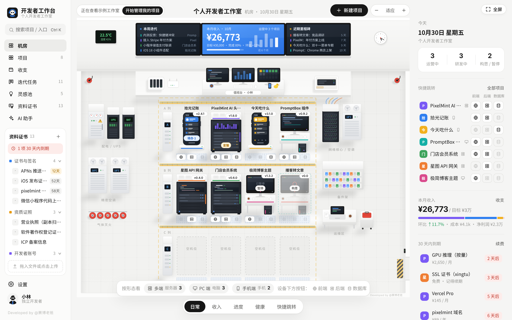
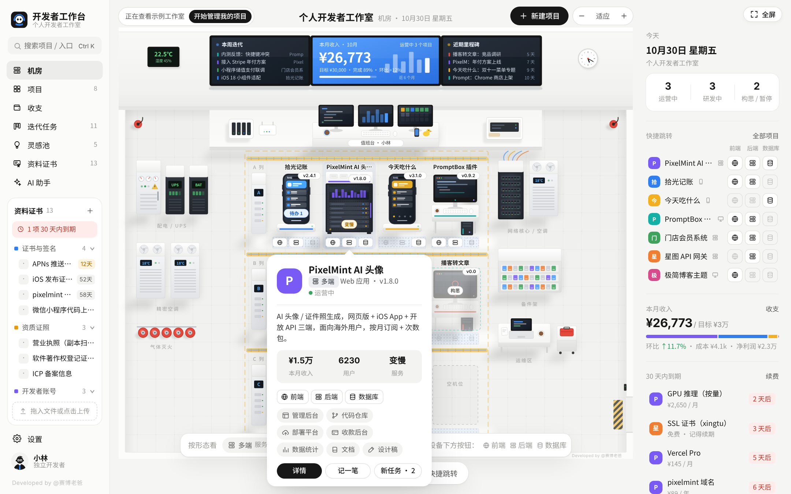
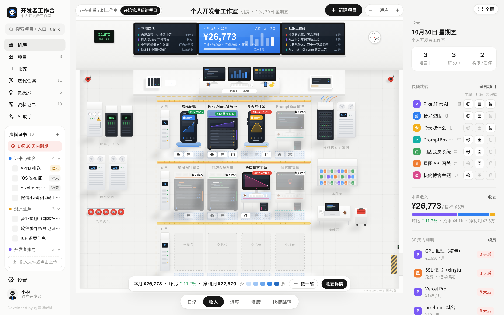
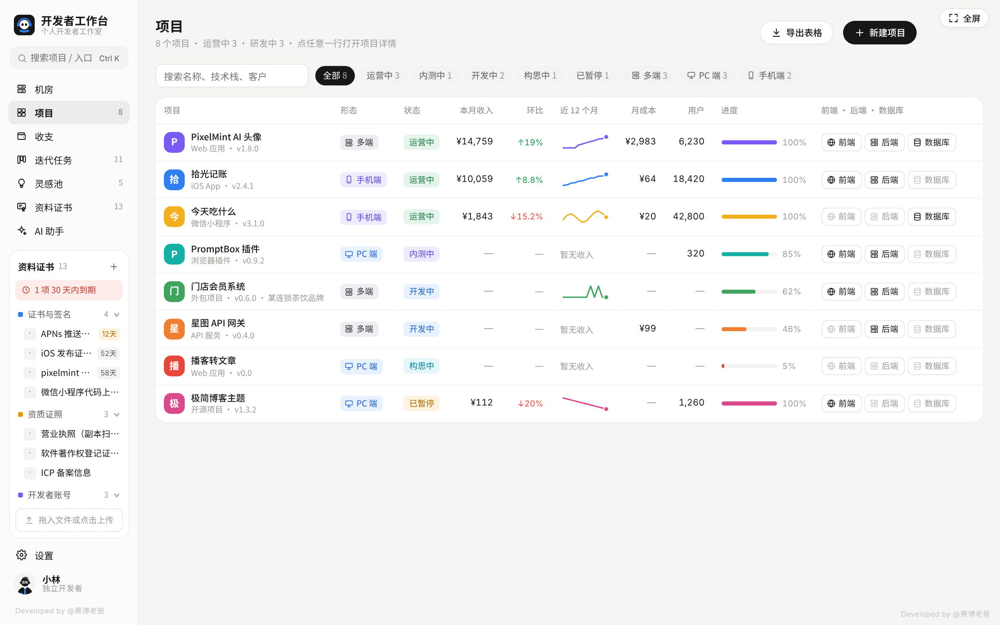
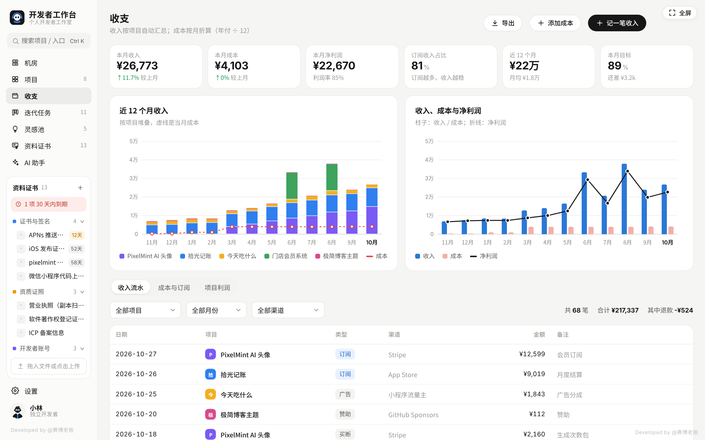
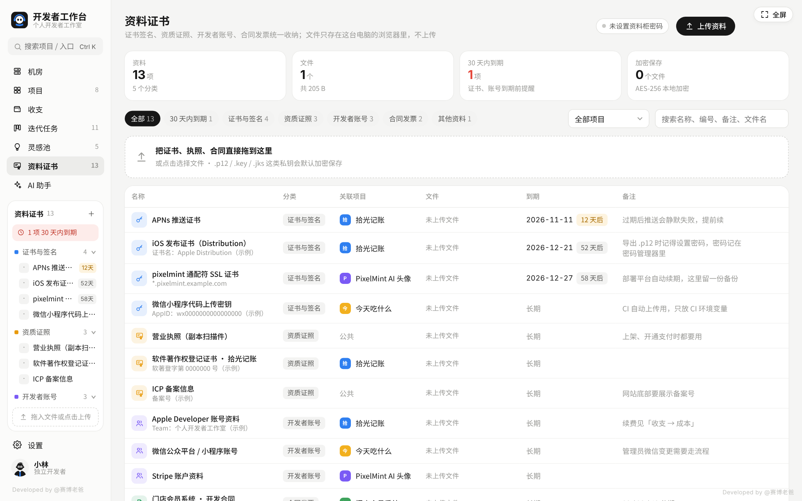
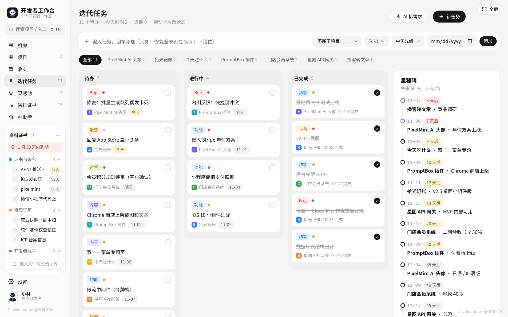
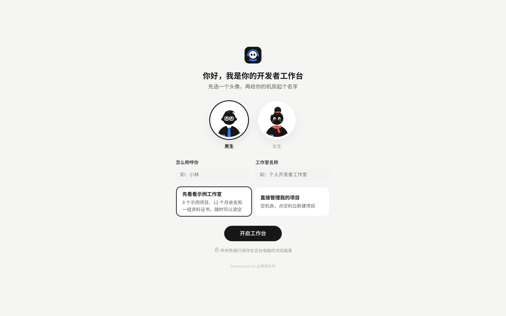
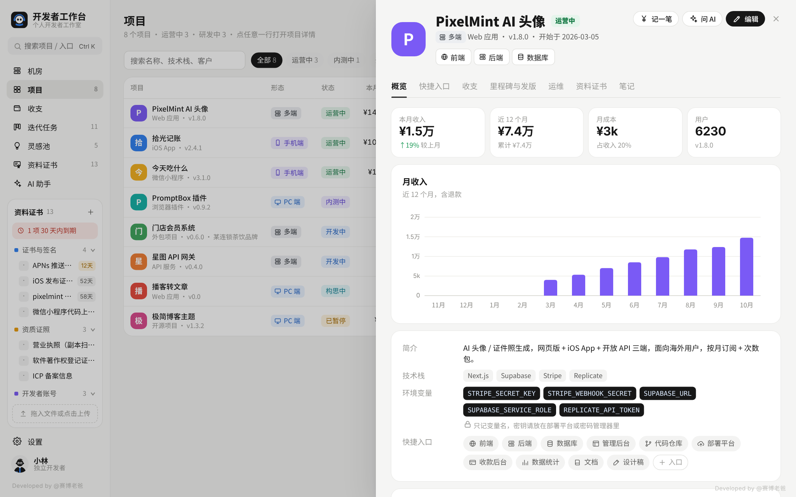
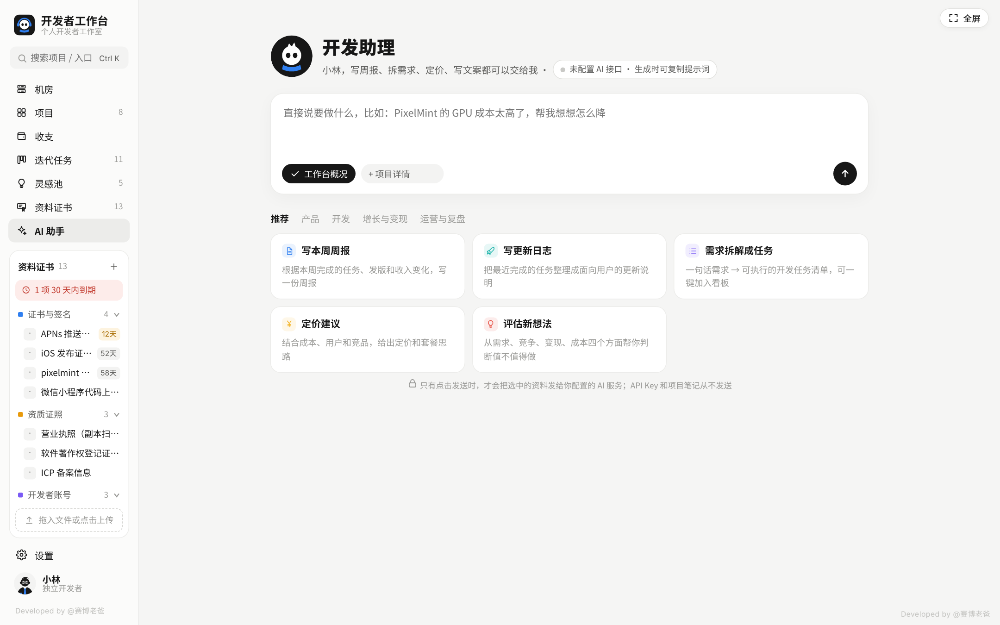

# Workstation OPC · 开发者工作台

> 个人工作台系列 · 第 2 期　|　单文件 HTML · 打开就能用 · 数据默认保存在本机浏览器


**Workstation OPC**（开发者工作台）是一款面向独立开发者、一人公司经营者的桌面浏览器个人工作台。它把项目入口、收支、迭代任务、资料证书和 AI 助手集中到一个页面，帮助你管理从想法、开发到上线运营的日常工作。单文件 HTML，无需安装依赖；当前为单人本地版，个人使用免费，商业使用按 [LICENSE](LICENSE) 申请授权。

手上同时有好几个项目的独立开发者，常见的麻烦是：哪些还在开发、哪些已经上线记不清；每个项目到底赚了多少钱算不明白；前端、后端、数据库的地址散落在一堆书签里；证书、营业执照、合同找不到，过期了才发现。

开发者工作台把你所有的项目放进一间「机房」：**多端项目是服务器机柜，PC 端项目是电脑，手机端项目是手机**。每台设备下面有前端、后端、数据库三个按钮，点一下就打开。收入、成本、利润按项目自动汇总，证书和资料拖进来就收好，到期前会提醒你。



---

## 目录

- [功能一览](#功能一览)
- [快速开始](#快速开始)
- [使用说明](#使用说明)
  - [机房（主页）](#机房主页)
  - [项目](#项目)
  - [收支](#收支)
  - [迭代任务](#迭代任务)
  - [灵感池](#灵感池)
  - [资料证书](#资料证书)
  - [AI 助手](#ai-助手)
  - [设置](#设置)
- [数据与隐私](#数据与隐私)
- [AI 接口配置](#ai-接口配置)
- [快捷键](#快捷键)
- [常见问题](#常见问题)
- [许可协议](#许可协议)

---

## 功能一览

| 模块 | 能做什么 |
|---|---|
| **机房** | 每个项目一台设备：多端 = 服务器、PC 端 = 电脑、手机端 = 手机；5 种查看模式（日常 / 收入 / 进度 / 健康 / 快捷跳转）；拖动换机位；前墙大屏显示本月收入、本周迭代、近期里程碑和到期提醒 |
| **一键跳转** | 每台设备下方都有「前端 · 后端 · 数据库」三个按钮；右侧栏、项目列表、项目详情里也有；另外还能存管理后台、代码仓库、部署平台、收款后台、数据统计、文档、设计稿 7 类入口；`Ctrl / ⌘ + K` 搜索直达 |
| **项目** | 项目档案：形态、状态、版本、用户数、进度、技术栈、环境变量名、里程碑、发版记录、笔记；外包项目可记客户和合同金额 |
| **收支** | 按项目记收入（订阅 / 买断 / 广告 / 外包 / 赞助 / 退款）；成本按月折算；项目利润表；订阅收入占比；导出表格 |
| **迭代任务** | 三列看板，拖动改状态；回车快速添加；里程碑时间线 |
| **灵感池** | 需求强度、变现能力、竞争程度、开发成本四项打分，一键立项 |
| **资料证书** | 证书签名、资质证照、开发者账号、合同发票统一收纳；拖文件进窗口就能存；私钥类文件可加密保存；到期提醒 |
| **到期提醒** | 服务器、域名、开发者账号的续费，加上证书、资料的到期日，合在一起提前 30 天提醒 |
| **服务检测** | 手动检测各项目前端 / 后端的浏览器可达性和响应耗时，查看最多 30 个检测日期的历史结果 |
| **AI 助手** | 13 个常用模板：周报、更新日志、需求拆解、定价建议、想法评估、PRD、排查 Bug、代码审查、上线清单、产品文案、回复用户、收入复盘、外包报价；支持国内外主流大模型，不配置也能用 |

|  |  |
|---|---|
| 悬停设备：收入、用户、服务状态、所有入口 | 收入模式：按本月收入深浅着色，屏幕显示近 6 个月曲线 |
|  |  |
| 项目列表：形态、状态、收入、进度、一键跳转 | 收支：按项目堆叠的收入、成本和净利润 |
|  |  |
| 资料证书：左侧常驻，拖进来就收好 | 迭代任务：看板 + 里程碑 |

---

## 快速开始

**在线体验：[打开 Workstation OPC](https://cyberdaddyleo.github.io/workstation-OPC/)**。建议使用桌面版 Chrome 或 Edge；数据保存在当前浏览器，不会在不同设备或网址之间自动同步。

### 方式一：下载后直接打开（推荐）

1. 下载本仓库里的 `index.html`（或者在 Releases 页面下载）
2. 双击用 **Chrome** 或 **Edge** 打开
3. 第一次打开会看到欢迎页：选个头像、填个称呼，然后二选一
   - **先看看示例工作室**：8 个示例项目、12 个月收支、一组资料证书，随时可以清空
   - **直接管理我的项目**：空机房，点空机位新建项目

不需要安装任何东西，也不需要联网（只有用到 AI 助手和服务检测时才需要网络）。



### 方式二：放到自己的网站上

`index.html` 是一个完整的单文件，可以直接放到 GitHub Pages、Cloudflare Pages 或任何静态网站托管上访问。
Fork 本仓库后，在仓库的 **Settings → Pages** 里选择 `main` 分支根目录，等一会儿就能在线打开。

> 注意：数据存在**打开它的那个浏览器**里。换了网址、换了浏览器、换了电脑，数据不会自动跟过去，请用「设置 → 数据与备份」导出、导入。

**建议环境**：Chrome / Edge 最新版，屏幕宽度 1280 以上效果最好。

---

## 使用说明

### 机房（主页）


**看懂机房**

- **设备 = 项目**。新建项目时选「项目形态」，决定它显示成什么设备：

  | 形态 | 显示为 | 适合 |
  |---|---|---|
  | 多端 | 服务器机柜 | 网页 + App + 后端，多个端一起跑的项目、API 服务、外包系统 |
  | PC 端 | 电脑 | 网页应用、桌面软件、浏览器插件 |
  | 手机端 | 手机 | iOS / Android App、小程序 |

- **设备上的颜色条**是项目颜色；**指示灯**表示状态：绿色运营中、蓝色开发中、紫色内测中、灯灭是已暂停，红灯闪烁是服务连不上。
- **开发中的项目**：服务器会按进度一台台装满，手机会显示还没做完的页面骨架。
- **构思中的项目**是半透明的，外面有一圈虚线。
- **前墙大屏**：左边本周迭代，中间本月收入和目标完成度，右边近期里程碑；屏幕够宽时两侧还有本月收入榜和到期提醒。点击可以跳到对应页面。
- **右侧栏**：项目数量、快捷跳转、本月收入、30 天内到期、服务状态、今天要做的事和最近动态。

**常用操作**

| 想做什么 | 怎么做 |
|---|---|
| 打开某个项目的前端 / 后端 / 数据库 | 点设备下方对应的按钮（地球 = 前端，叠放的服务器 = 后端，圆柱 = 数据库）。按钮是虚线表示还没填，点一下直接跳到填写的地方 |
| 看项目概况 | 鼠标停在设备上 |
| 打开项目详情 | 点击设备 |
| 新建项目 | 点空机位，或右上角「新建项目」 |
| 换位置 | 按住设备拖到空机位就搬过去；拖到另一台设备上，两个项目互换位置 |
| 只看某一类项目 | 日常模式底部点「多端 / PC 端 / 手机端」，再点一次取消 |
| 缩放、移动 | 按住 `Ctrl / ⌘` 滚动滚轮缩放；按住空白处拖动；点「适应」恢复 |

**5 种模式**（底部切换）

| 模式 | 看什么 |
|---|---|
| 日常 | 版本号、待办、告警（宕机 / 变慢 / 今天到期的任务） |
| 收入 | 本月收入和环比，收入越多颜色越深，屏幕显示近 6 个月曲线 |
| 进度 | 开发进度百分比、最近的里程碑倒计时 |
| 健康 | 最近检测状态、响应耗时和检测历史；点「实时检测」手动检测一次 |
| 快捷跳转 | 点设备弹出这个项目的全部入口 |

> 服务检测需要手动触发，最多保留 30 个检测日期的结果。界面中的「在线率」是根据检测结果换算的状态参考值，不代表持续监控统计的真实可用率；浏览器可达也不等于服务业务功能正常。

### 项目



- **项目列表**：形态、状态、本月收入、环比、近 12 个月曲线、月成本、用户数、进度，以及「前端 · 后端 · 数据库」三个按钮。可以按状态、形态筛选，也能导出表格。
- **新建 / 编辑项目**：名称、类型、项目形态（会按类型自动推荐）、状态、版本、用户数、进度、颜色、简介、技术栈、环境变量名、客户和合同金额，以及 10 类入口地址。
- **项目详情**有 7 个标签：
  - **概览**：收入、成本、用户、进度，月收入图，技术栈，待办任务
  - **快捷入口**：10 类入口卡片，点击打开，悬停可以复制地址
  - **收支**：这个项目的收入记录和成本
  - **里程碑与发版**：里程碑打勾；记录每次发版，发到生产时自动更新当前版本
  - **运维**：前端 / 后端最近检测状态、手动检测历史、到期和续费
  - **资料证书**：和这个项目有关的证书、合同、账号资料
  - **笔记**：常用命令、服务器信息、踩坑记录，自动保存

> 环境变量只记**名字**（比如 `STRIPE_SECRET_KEY`），不要在任何地方填密钥本身。

### 收支

- **记一笔收入**：选项目、日期、金额、渠道、类型。选「退款」会自动记成负数。
- **添加成本**：服务器、数据库、域名、证书、AI 接口、开发者账号、工具订阅等。周期选「月 / 年 / 一次性」，年付会自动除以 12 算到每个月。可以不属于任何项目（算作公共成本）。
- **续费**：填上下次续费日期，提前 30 天出现在提醒里；续费后点「已续费」，日期会自动往后推一个周期。
- **项目利润**：每个项目本月和近 12 个月的收入、成本、利润和利润率，公共成本单独一行。
- 右上角「导出」可以导出收支明细表格。

### 迭代任务

- 顶部输入框写任务，回车添加，可以同时选项目、类型、优先级和截止日期。
- 三列看板：待办 / 进行中 / 已完成，**拖动卡片**改状态，点圆圈直接完成。
- 右边是未来 60 天所有项目的里程碑。
- 「AI 拆需求」可以把一句话需求拆成任务清单，再一键加入看板。

### 灵感池

- 记下想法，给四项打分（1–5）：需求强度、变现能力、竞争程度（越高扣分越多）、开发成本（越高扣分越多），自动算出 0–100 分。
- 分高的先做；点「立项」会自动建成项目，分配一个空机位。
- 「AI 评估」会从目标用户、竞品、收费方式、最小可行版本几个方面帮你判断值不值得做。

### 资料证书


左侧栏下半部分常驻「资料证书」，也可以从导航进入完整页面。

- **5 个分类**：证书与签名（iOS 证书、描述文件、Android 签名、SSL 证书、推送证书）、资质证照（营业执照、软件著作权、ICP 备案、商标）、开发者账号、合同发票、其他资料。
- **收纳文件**：把文件拖进窗口**任意位置**，或点左侧「拖入文件或点击上传」。会按文件名自动猜分类，可以一次放多个。
- **每一项可以记**：名称、分类、关联项目、编号 / 账号（证书编号、备案号、AppID、登录邮箱）、到期日、备注、多个文件。
- **到期提醒**：填了到期日，提前 30 天出现在左侧栏、机房右侧栏和前墙大屏上。
- **取回文件**：列表里点文件名直接下载；打开某一项资料后，图片、PDF、文本文件可以直接预览。
- **加密保存**：`.p12 / .pfx / .key / .jks / .keystore / .p8 / .pem` 这类私钥文件默认勾选「加密保存」。第一次加密时设置一个**资料柜密码**，之后下载加密文件需要输入它。
  - 密码**不会保存在任何地方**，忘了就解不开加密文件，请记在密码管理器里。
  - 输入一次后，本次打开期间不用重复输入；资料证书页右上角可以随时「上锁」。

> 编号 / 账号一栏不要填密码。账号密码请放在专门的密码管理器里，这里记一句「密码在哪」就行。

### AI 助手



- 直接说要做什么，或者点下面的模板。
- 发送时可以带上「工作台概况」（项目、收入、任务、到期、服务异常）或某个项目的详细资料，回答会结合你的真实数据。
- 回复可以复制、导出 Word、重新生成；「需求拆解」的结果可以一键加入迭代任务。
- **没有配置 AI 接口也能用**：点生成时会给你一段已经附好数据的提示词，复制到任意 AI 网页版（DeepSeek、Kimi、豆包、通义等）粘贴发送就行。

### 设置

| 分类 | 内容 |
|---|---|
| 我的形象 | 头像、称呼、身份（显示在侧栏，称呼会印在机房值班台的名牌上） |
| 工作室 | 工作室名称、月收入目标、货币符号（¥ / $ / HK$ / €，只改显示不换算）、机柜列数和每列台数、指示灯动画 |
| AI 接口 | 服务商、API Key、接口地址、模型名称、创造性，以及「测试连接」 |
| 数据与备份 | 导出备份、从备份恢复、载入示例、清空全部数据 |
| 关于 | 版本、许可、快捷键 |

---

## 数据与隐私

- **工作台数据默认保存在当前电脑的浏览器里**，不会自动上传给作者；使用 AI 接口和服务检测时会产生下面说明的网络请求。
  - 项目、收支、任务等数据存在浏览器的 localStorage；
  - 资料证书的文件存在浏览器的 IndexedDB。
- **点击发送或生成时**，AI 助手会把你的输入和选中的工作台上下文发给你配置的 AI 服务；「测试连接」也会向该服务发送测试请求。自动组装的上下文不包含项目笔记和资料证书文件，但你主动粘贴的内容会随请求发送。
  - API Key 保存在本地设置中，并通过请求头发送给你配置的 AI 接口用于鉴权，不会加入提示词；使用本地中转时会经中转转发。
- **服务检测**由你手动触发，浏览器直接请求填写的前端 / 后端地址，记录可达性和请求耗时，不读取响应内容；它不是持续运行的监控服务，也不能判断所有 HTTP 错误或业务故障。
- **清理浏览器数据会把工作台数据一起清掉。** 换电脑、重装系统、清理浏览器之前，请到「设置 → 数据与备份」导出备份。
  - 备份是一个 `.json` 文件，**包含工作台数据、AI 设置（含已填写的明文 API Key）和资料证书里的全部文件**；加密文件在备份里仍然是加密的。请妥善保管备份，不要公开上传或分享。
  - 在新电脑上打开 `index.html`，「从备份恢复」即可。
- 浏览器的无痕 / 隐私模式下，关闭窗口后数据会丢失。

---

## AI 接口配置

在「设置 → AI 接口」选择服务商，填 API Key 就能用。已经预设好接口地址和模型的服务商：

DeepSeek、通义千问（阿里云百炼）、Kimi（月之暗面）、智谱 GLM、豆包（火山方舟）、硅基流动、OpenAI、Claude（Anthropic）、Ollama 本地模型，以及任何兼容 OpenAI `/chat/completions` 格式的自定义接口（如 one-api、new-api 中转）。

> 各家模型名称会更新，如果提示模型不存在，请到服务商控制台查看最新的模型名，填到「模型名称」里。

**提示「连不上」怎么办？**

网页直接调用 AI 接口时，有些服务商会拦截（跨域限制）。可以：

1. 换一家服务商试试；
2. 使用仓库里的本地中转 `ai-proxy.js`：
   ```bash
   # 电脑上装好 Node.js（16 以上）后，在 ai-proxy.js 所在文件夹运行：
   node ai-proxy.js
   ```
   然后把「接口地址」改成 `http://127.0.0.1:8787/` 加上原来的地址，例如：
   ```
   http://127.0.0.1:8787/https://api.deepseek.com
   ```
   中转只在你自己电脑上运行（只监听 127.0.0.1），不保存、不记录任何内容。

**Ollama 本地模型**：不需要 Key；需要先设置环境变量 `OLLAMA_ORIGINS=*` 再启动 Ollama，允许网页访问。

---

## 快捷键

| 按键 | 作用 |
|---|---|
| `Ctrl + K`（Mac：`⌘ + K`） | 搜索项目，直接点图标跳转入口 |
| `Esc` | 关闭弹窗、抽屉 |
| `Ctrl / ⌘ + 滚轮` | 缩放机房 |
| `Enter` / `Shift + Enter` | AI 助手：发送 / 换行 |
| 拖文件进窗口 | 收进资料证书 |

---

## 常见问题

**打开后是空白的？**
请用 Chrome 或 Edge 最新版打开。如果是从聊天软件或网盘里直接预览的，请先下载到电脑上再双击打开。

**示例数据怎么清空？**
机房左上角点「开始管理我的项目」，或者「设置 → 数据与备份 → 清空全部数据」。

**机位不够了？**
「设置 → 工作室 → 机位」里加机柜列数或每列台数。暂时不做的项目可以把状态改成「已归档」，它会从机房里移走，但数据保留。

**服务检测显示「无法连接」，但网站明明能打开？**
需要登录才能访问、在内网、或者拦截了跨站请求的地址，浏览器检测可能会误判。示例数据里的地址都是占位地址，检测会显示无法连接，换成你自己的地址就正常了。

**资料柜密码忘了怎么办？**
没有办法找回，加密文件也无法解开，这是为了保证只有你能打开。没加密的文件不受影响。

**能在手机上用吗？**
当前是电脑版，手机上显示会比较挤。手机版会放在后续版本里。

**能多人一起用吗？**
当前是单人本地版，数据不同步。可以用「导出备份 / 从备份恢复」在不同电脑之间搬数据。

---

## 版本记录

见 [CHANGELOG.md](CHANGELOG.md)。

## 个人工作台系列

一个职业一个工作台，打开就能用，数据默认保存在本机浏览器。

- 第 1 期：班主任工作台
- 第 2 期：开发者工作台（本仓库）
- 更多职业持续更新中

---

## 许可协议

**个人使用免费，商业使用需要授权。** 完整条款见 [LICENSE](LICENSE)。

| 可以（免费） | 需要先取得作者书面授权 |
|---|---|
| 个人自己使用，包括独立开发者用它管理自己的项目和收入 | 出售、出租或付费分发本软件及修改版 |
| 学习、研究、修改源码、做二次开发自己用 | 打包进付费产品、付费课程、付费社群、会员资源 |
| 免费分享给别人（保留署名、水印和 LICENSE） | 用本软件或修改版对外提供付费服务、SaaS、托管服务 |
| 把修改版免费公开（注明改动，同样遵守本协议） | 公司、团队或其他组织内部部署给多人使用 |
|  | 给客户定制、部署本软件并收费 |

不允许去掉「Developed by @赛博老爸」署名和水印，也不允许以自己的名义重新发布。

**商业授权**：请在本仓库提交 Issue 说明用途，或在各平台搜索「赛博老爸」私信联系。

---

<sub>Developed by @赛博老爸</sub>
